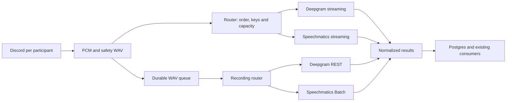

# Plan: Deepgram and Speechmatics with preference and fallback

Date: 2026-10-03. Status: implementation available; validation with local simulators and PostgreSQL.
PT-PT quality rehearsal and real credentials remain to be done.

## Intended outcome

Add Deepgram to the bot with several API keys, streaming and WAV file
transcription. Allow choosing the order of the providers, initially
`deepgram,speechmatics`, and fall back in both directions. `/keys` presents
information from both, even when one of them is only the fallback provider.

The implementation is feasible with the existing architecture: Go already captures audio per
participant, stores a safety WAV and sends PCM to the Python API; the API already has
reservations, durable queues, generations and replacement of streaming results by Batch.
The main work is to generalise the decisions that are today specific to Speechmatics and
add two Deepgram adapters. PT-PT accuracy will have to be measured with real
audio; the integration, by itself, does not demonstrate an improvement in recognition.

## 1. Confirmed Deepgram limits

Query to the official documentation on 2026-10-03:

| Plan / region | Nova-3 streaming | Nova-3 simultaneous recordings |
| --- | ---: | ---: |
| Pay As You Go, including the European endpoint | Up to 150 | Up to 50 |
| Growth, North America | Up to 225 | Up to 50 |
| Growth, Europe | Up to 150 | Up to 50 |

The limits are **per project, not per API key**. Two keys of the same project
share the capacity; creating additional keys does not increase the number of streams.
Secondary projects of self-service accounts are restricted to one stream. The documentation
also prohibits distributing traffic across accounts/projects to circumvent limits.
These values are documented limits, not a verification of the quotas of a concrete
account. [Source: API Rate Limits](https://developers.deepgram.com/reference/api-rate-limits).

Implementation decision: control capacity per quota/project group, with separate
counters for streaming and recordings. Do not copy the Speechmatics rule
of two slots per key to Deepgram. Repeated keys are deduplicated. A `429` temporarily
blocks new admissions in the affected group; rotating to another key of that group
does not solve the lack of capacity.

The bot already identifies who is speaking through Discord. Do not enable remote diarization:
it is not necessary for this path and has its own limits.

## 2. Existing base and necessary changes

| Area | Observed state | Planned change |
| --- | --- | --- |
| `discord_bot/audio_convert.go` | Opus → stereo 48 kHz PCM; WAV per user; RTP recovery | Reuse capture and define immediate WAV rotation when the assignment changes |
| `discord_bot/streaming.go` | Mono PCM, internal WebSocket, reservations and assistant events | Add provider to the assignments and manage transitions without resending old audio to the assistant |
| `app/realtime.py` | Pool with two slots per key; Speechmatics protocol inside the bridge | Admission by group and adaptation of the protocols per provider |
| `app/streaming_routes.py` | Streaming requires `transcription_provider == speechmatics` | Evaluate the effective order and the capabilities of all eligible providers |
| `app/transcriber.py` and `app/main.py` | Whisper/Speechmatics; Speechmatics job recovery with sidecar | Recording router with fallback and Deepgram adapter |
| `app/speechmatics_errors.py` | Key state and errors specific to Speechmatics | Separate the normalized parsing error of each provider |
| `src/data/repository.py` | Generations, idempotent finals, Batch/Realtime swap, Realtime consumption | Persist preference, result origin and attempts per provider |
| `discord_bot/main.go` and `transcription_client.go` | `/keys` queries Speechmatics exclusively | Aggregated endpoint and presentation per provider/project/key |
| `discord_bot/speechmatics_usage_alerts.go` | Alerts depend on the selected provider | Continue to monitor Speechmatics when it is fallback, without duplicating shared usage |

The `app/...` references correspond to `src/transcription-api/app/...`.
There are local changes in `.env.example`, README, Compose and assistant files;
re-read the state before implementation and integrate without replacing that work.

## 3. Configuration and order selection

```dotenv
# New installations: order common to streaming and recordings.
TRANSCRIPTION_PROVIDER_ORDER=deepgram,speechmatics

# Keep compatibility with old deployments that only define this variable.
TRANSCRIPTION_PROVIDER=speechmatics
TRANSCRIPTION_STREAMING_ENABLED=false

DEEPGRAM_API_KEY=
DEEPGRAM_API_KEY_01=
DEEPGRAM_API_KEY_02=

DEEPGRAM_API_BASE_URL=https://api.deepgram.com/v1
DEEPGRAM_REALTIME_URL=wss://api.deepgram.com/v1/listen
DEEPGRAM_MODEL=nova-3
DEEPGRAM_LANGUAGE=pt-PT
DEEPGRAM_KEYTERMS=
DEEPGRAM_ENDPOINTING_MS=500

# Optional for querying management/usage/balance and identifying the quota group.
DEEPGRAM_PROJECT_ID=
# Optional override for a key with a different association.
DEEPGRAM_PROJECT_ID_02=

# Local admission limits for the main group; adjust to the real quota.
DEEPGRAM_STREAMING_LIMIT=150
DEEPGRAM_BATCH_LIMIT=50
# Overrides per project/group, using the same suffix as the association.
DEEPGRAM_STREAMING_LIMIT_02=1
DEEPGRAM_BATCH_LIMIT_02=1
```

Rules:

1. Preference persisted per guild wins over the environment. In its absence, use
   `TRANSCRIPTION_PROVIDER_ORDER`; if that is not defined, use only the
   old `TRANSCRIPTION_PROVIDER`. Do not enable new providers silently
   in an old deployment. The new example recommends Deepgram first.
2. Accept the orders `deepgram,speechmatics`, `speechmatics,deepgram` and individual
   selection of one of the two. Normalize spaces/capitalisation and reject duplicates
   or unknown providers. Whisper remains available through the old mode;
   automatic fallback to Whisper is outside this plan.
3. Providers without keys are visible as not configured and are ignored by the
   router. An order without any configured provider returns an error before it is saved.
4. Enumerate `DEEPGRAM_API_KEY` and `DEEPGRAM_API_KEY_*` with deterministic ordering,
   as already happens with Speechmatics. Store secrets exclusively in the Python API.
5. Keys without an explicit association share a single Deepgram group, including when
   there is no `PROJECT_ID`. An API key is enough to transcribe; the project ID is optional for
   management. `/keys` shows an unverified association when applicable.
6. Explicit association and management metadata must be reconciled when
   permissions allow it. If several keys point to the same project, combine their
   counters and use the lowest configured limit in case of conflict. Never add
   limits per key nor assume extra capacity from secondary projects. Unknown
   identities do not generate additional capacity: until the real association is confirmed,
   also apply a conservative aggregate ceiling to the Deepgram set. Limit overrides
   are local ceilings, not a declaration of quota granted by the provider.
7. For Speechmatics, preserve the current operational rule of two reservations per distinct
   key and the earlier premise of distinct accounts, clearly identified as
   local configuration. Real provider refusals prevail over that premise.
8. REST/WS endpoints must have a consistent region. Do not add capacity by switching
   endpoint. Do not use key management nor automatic project creation.

## 4. Commands and endpoints

Add `/stt` with subcommands:

```text
/stt status
/stt order providers:deepgram,speechmatics
/stt order providers:speechmatics,deepgram
```

`providers` uses Discord choices, including each provider alone. The change
requires the same server management permission used by `/streaming`, is persisted
before confirmation and works without restart. `status` reports the effective order,
the source of the preference, the configuration, the providers in use and the streaming mode.
Ephemeral configuration response; names and descriptions in PT/EN according to the current standard.

New internal endpoints:

- `GET /v1/guilds/{guild_id}/transcription`: effective order and source.
- `POST /v1/guilds/{guild_id}/transcription`: validation/persistence of the order.
- `GET /v1/transcription/keys?guild_id=...`: aggregated state per provider.

Reuse the streaming endpoints, including `/v1/streaming/audio`.
Preserve `/v1/speechmatics/keys` and the old client during the transition, but remove
the block that hides Speechmatics when another provider is first.

The new order applies to the next admissions and the next WAV limits.
Do not interrupt a healthy connection in the middle of a sentence to change the preference.
When a manual change requires migrating a stream, close/flush the current unit and
open the next one with the new order. A recovery already running keeps the decision
and the attempt identification, avoiding reinterpreting a remote job as another provider.

## 5. Minimal architecture



Use `httpx` and `websockets`, already installed. There is no need to add the Deepgram
SDK, a queue service or an external coordinator. Introduce a small router for
the two providers and a Realtime contract to open/send/close/normalize.
Keep `TranscriptionResult`/`TranscriptionSegment` as the result of recordings.

Authority over keys and capacity remains in the API, in a single process. REST counters
shared between workers and WS reservations must use safe synchronisation between
threads/event loop; do not perform network I/O under the lock. Reservations count even before
opening the connection and are released only once, including cancellation and handshake failure.
Multiple processes/replicas would require shared coordination and are outside the scope.

## 6. Deepgram adapters

### Streaming

Use Nova-3 with `language=pt-PT`, `linear16` audio, 48 kHz and one channel; authentication
by `Authorization: Token ...`. Go already performs the stereo → mono conversion before the
internal WebSocket. Request partials and punctuation. Normalize `Results`: `is_final`
determines persistence; `speech_final` indicates end of speech, it does not replace that rule.
Map words and times to the `final` event already consumed by the assistant.
[Official protocol](https://developers.deepgram.com/reference/speech-to-text/listen-streaming).

Do not expect `RecognitionStarted` from Deepgram: the adapter confirms the WS handshake
before returning `ready`. Preserve internal sequences, buffer limits, DTX silence,
offsets and validation of times relative to the samples sent.

During a wait without sending audio, emit a textual `KeepAlive` at an interval of five
seconds. Do not confuse heartbeat with audio samples nor remove silence from the
existing path without updating the time map.
[KeepAlive](https://developers.deepgram.com/docs/audio-keep-alive).

On the normal closing of the unit, `CloseStream` requests processing of the remaining audio;
consume the finals and closing metadata before confirming completion, with a limited
timeout. If the closing is incomplete, recover through the WAV. `Finalize` is an operation
of flush and is not a generic confirmation of success of the whole stream.
[CloseStream](https://developers.deepgram.com/docs/close-stream),
[Finalize](https://developers.deepgram.com/docs/finalize).

### WAV recordings

Send the local file to `POST /v1/listen` with Nova-3, `pt-PT`, punctuation and
`utterances=true`. Convert the returned intervals into segments and use words
as a segmentation alternative when necessary. Validate empty results,
times and duration; legitimate silence can produce an empty result with success.
[Recordings API](https://developers.deepgram.com/reference/speech-to-text/listen-pre-recorded).

Derive a temporary mono WAV from the stereo safety WAV, preserving
the number of frames and the duration; send its content with `Content-Type: audio/wav`.
Keep the original for recovery and clean the derivative after the attempt.
Do not configure diarization/multichannel per participant. Do not load the whole
recording into memory; send it in chunks with the existing timeouts and limits.

Start with synchronous REST in the existing workers. Persist the `request_id` and
the result received before the final write to the DB, through a sidecar written
atomically and without secrets. After restart, reuse that result when present.
If the response is lost after sending, it may be necessary to repeat the transcription,
with repeated cost: local idempotency does not guarantee billing exactly once.
Do not treat `request_id` as a queryable Speechmatics job.
Extend the normal cleanup, recovery and `/forget` to the new derived WAVs and sidecars;
these contain audio/text and must have the same lifecycle as the original unit.

`DEEPGRAM_KEYTERMS` must apply to both modes, encoded as repeated `keyterm`
parameters. For Nova-3 use `keyterm`, not the legacy `keywords` parameter.
[Keyterm Prompting](https://developers.deepgram.com/docs/keyterm).

## 7. Preference, fallback and recovery

### Selection

Traverse providers by the effective order. Within each one, choose a healthy
key, respecting the group limit, with lowest occupancy and deterministic tie-break.
Do not depend on the success of the balance query to admit transcription.

For the order `deepgram,speechmatics`, try eligible Deepgram keys and then
Speechmatics; with the reverse order, do the opposite. Attempts are limited per
unit/episode: store the candidates already tried and never circulate infinitely
between the same providers.

Fallback resolves service, credential, credit or capacity failures. A response
with incorrect words can be technically successful; there is no reliable automatic
detection of that in this version. The preference must be chosen by the quality rehearsal,
without sending all speech simultaneously to both providers.

### Errors and scope

| Situation | Action |
| --- | --- |
| Invalid key/without permission to transcribe | Disable that key for the affected mode; try another and then another provider |
| Management/usage/balance without permission | Show information unavailable; do not disable transcription |
| `402`/confirmed lack of credits | Mark the affected billing group; try another legitimately configured group or provider |
| `429`/capacity | Cooldown of the group/product; try another provider; do not rotate keys of the same group to circumvent the limit |
| Timeout, network, `5xx`, abnormal closing | Limited retry and cooldown; another provider; preserve the WAV |
| Invalid PCM/WAV file or invalid internal contract | Fail the unit and diagnose; do not try the same invalid input indiscriminately |
| No slots in any streaming | Continue WAV/Batch; FIFO queue for future promotion |

Deepgram documents authentication/permission errors, `402` for credits and `429` for
limits. Interpret structured codes and the product/operation, without generically classifying
any management `401`/`403` as an invalid key for STT.
[Errors](https://developers.deepgram.com/docs/errors).

Minimum state: key, group and provider can be healthy, not configured,
invalid, without credits or in cooldown. Do not confuse local budget, temporary unavailability
and balance. Cooldown recovers automatically with a controlled attempt;
exhaustion/invalidity requires changing credentials or explicit revalidation.

### Streaming failure during speech

1. Opening failure: try the next candidate before emitting `ready`, within the
   Go client's handshake budget (currently 15 s). Adjust client/API together
   if the budget is insufficient; never keep Go waiting indefinitely.
2. Failure after sending audio: close the unit's owner, invalidate its generation and
   preserve the WAV. The audio of that unit follows recovery by recording.
3. Go immediately rotates the WAV at an explicit limit, synchronizes the assignment and
   opens a new unit with another available provider. If no stream is
   available, it records until it can promote. Do not wait until the end of the call to react.
4. The Batch router receives the reason and the failed provider to avoid immediately trying the
   candidate in cooldown. It follows the order among eligible candidates; the recovery
   does not retroactively change the persisted preference.
5. Recovery results replace the previous finals of the same unit in one
   transaction, using the existing mechanism. Late events of the old generation are
   ignored. The recovery is not published to the assistant's event channel.
6. Finals already delivered to the assistant are not executed again after the swap.
   Invalidate ongoing context when it loses the unit, preserve protection by
   identity/generation and verify the assistant's behaviour in the transition.

When the preferred provider recovers, use it for the new admissions. Healthy streams
in fallback keep their holder until the next normal rotation; do not migrate in the middle
of speech nor remove another participant's slot. Preserve FIFO, participant exits,
channel changes and the current rule of one active call.

### Failure of all providers

Only apply the current discard for credits when **all remote providers configured and
allowed by the order** have confirmed a lack of credits and there is no pending remote
attempt capable of completing. An invalid key or timeout does
not constitute confirmation of exhausted credits.

If a lack of credits in one provider coexists with a temporary failure in the other, preserve
audio for durable retry. If there is no usable credential by configuration
or authentication, suspend new capture for transcription and explain the situation, without
attributing it to credits nor automatically deleting the pending one for that reason.

Generalise the current credits warning to the affected providers; keep the pending
cleanup recoverable, the preservation of completed text and the `/forget` rules.
Do not emit automatic warnings on Discord for each provider change: the fallback state
appears in the commands and logs. The terminal warning follows the existing policy.

## 8. Persistence and accounting

Add an additive migration, predictably `009_transcription_providers.sql`
(confirm the numbering in the implementation; the project has migrations up to `008`).

- `guild_transcription_settings.provider_order`: nullable array; `NULL` uses the environment.
- Unit metadata: chosen provider, model and group; origin of the final
  result and recovery reason. Reuse WAV identity and `generation`.
- `voice_transcription_attempts`: attempt per unit, generation, product
  (`streaming`/`batch`), provider, key by name, group, model, state, duration
  sent, timestamps, normalized error and remote identifier when available.

This table allows attributing consumption to both providers when the same unit
goes through streaming and recovery. Use monotonic checkpoints; do not add successive
checkpoints of the same attempt. Do not store secrets or transcriptions in this table.

Preserve recovery of Speechmatics `provider_job_id`/sidecars with the original provider
and key, even after changing the order. Before submitting to another provider,
query the existing job; if the remote recovery fails and there is fallback, persist
the new generation/owner and reject late results. Do not mix IDs of the two systems.

Keep reading the old sidecars. Infer historical origin only with evidence
(for example, Speechmatics `realtime_key_name` or a known sidecar/job); leave ambiguous
data as unknown. Do not attribute old Whisper recordings to Speechmatics.
Separate the existing historical accounting from the new records to avoid double counting.

## 9. `/keys`, `/streaming status` and `/health`

`/keys` presents first the effective order and then both providers:

- Configured, preference, models and streaming/recording availability.
- Per key: configuration name, state, local occupancy and last normalized error.
- Per group/project: shared occupancy, local limit, documented quota or
  unverified association; do not repeat the balance as if it belonged to each key.
- Local bot consumption separated by streaming/recordings, consumption reported by
  the provider, UTC period and query update.
- Deepgram reported balance when accessible; estimated costs with rate, date and
  source. Unknown values are `null`/unavailable, never zero.
- Speechmatics keeps the current distinction between remote Batch consumption, local Realtime,
  estimated cost and unavailable balance. Data from shared keys are not added.

Deepgram has query APIs for [balance per project](https://developers.deepgram.com/reference/manage/billing/list)
and [usage per project](https://developers.deepgram.com/reference/manage/usage/get).
Query once per project with an authorized credential; short cache and timeout per
provider. If permission/ID is missing, show local accounting and the limitation. Use
filters per key only when the endpoint used supports them; do not attribute the global
project consumption to each key. A Deepgram query failure does not hide Speechmatics.

Example merely illustrative, without real values:

```text
Order: 1. Deepgram → 2. Speechmatics

Deepgram · nova-3 · pt-PT
Main project: 4/150 local streaming reservations · reported balance $180.00
01: available · 3 streams · local usage 2h 10m
02: available · 1 stream · local usage 0h 45m · shares quota/balance with 01

Speechmatics · streaming enhanced / Batch melia-1
01: available · 0/2 local reservations · estimated cost $0.30
02: no confirmed credits · 0/2 local reservations
Speechmatics balance: unavailable
```

The counters are the bot's; do not pretend to know the occupancy of other clients of the same
project. The balance does not guarantee that an account cannot continue on a payment basis.
The credit state used in the router comes from the inference response, not only from the balance.

Responses with many keys must be split respecting Discord limits and use
interaction defer while querying the API. Do not display secrets, headers, reservation
tokens or raw provider messages. `/streaming status` discriminates reservations
per provider and queue; `/health` shows the order and the providers effectively used.

## 10. Implementation phases

1. **Configuration and common state:** order/key parser, groups, errors, selection and
   additive migration. Preserve the old mode and recovery of existing jobs.
2. **Deepgram WAV:** REST adapter, normalization, durable result, Batch router and
   fallback in both directions. Reuse workers and transactional replacement.
3. **Deepgram streaming:** WS adapter, pool per group, finalization, normalization
   of events/times and immediate switch to a new WAV/provider after failure.
4. **Commands and observability:** `/stt`, aggregated `/keys`, status/health, alerts
   and generalized credits warnings; update of the Go client and PT/EN.
5. **Operational configuration:** `.env.example`, Compose and READMEs. Rehearse both
   modes and controlled failures before recommending Deepgram in production.

Do not install new dependencies by default. Do not change capture, summaries, profiles,
TTS or music logic beyond the points necessary for the new router/events.

## 11. Validation and acceptance criteria

Focused tests, taking advantage of the existing suites:

| Scenario | Evidence required |
| --- | --- |
| Several Deepgram keys, same project | Aggregated occupancy; capacity is not multiplied; duplicates do not count |
| Limit exhausted and external `429` | Cooldown in the correct group; Speechmatics fallback; WAV preserved |
| Deepgram → Speechmatics and reverse order | Streaming and recordings work in both directions, with limited attempts |
| One invalid key and another valid one | Key switch; no incorrect global suspension |
| Management returns `401`/`403` | `/keys` shows management unavailability; STT continues |
| Failure in the middle of speech | WAV recovery and new stream; no interval lost in the transition |
| Repeated partials/finals/closing | Only finals persist; idempotency; coherent times and words |
| Fallback after partial finals of the unit | Transactional replacement, without duplicated messages or assistant actions |
| Credit runs out in only one provider | The other continues; no global discard |
| Credit runs out in all / mixed temporary failure | Discard only in the first confirmed case; durable retry in the second |
| Restart during REST/streaming | Recovers WAV, sidecar and Speechmatics jobs without changing the remote identity |
| Order changed/bot restart | Per-guild preference persists; applies at the defined limits |
| `/forget`, exit, channel change | Correct cancellation/cleanup; reservations released once |
| Many keys / management provider offline | Complete Discord response, partial per provider and without secrets |
| Streaming on/off, queue/promotion | Same capture, FIFO and recording guarantees as the current version |

Run the pertinent Python and Go tests, including concurrency in the changed code,
lint, `git diff --check` and Compose validation with placeholders. Record pre-existing
failures separately; do not expand the scope to fix them in this work.

Real rehearsal: PT-PT audio captured by the bot itself, with names/nicknames, game
terms, pauses and noise, sent to both providers. Compare text with a human
reference, omissions and time to finals. Test first one participant and then several;
simulate failures locally instead of exhausting real credits or saturating quotas.

Complete when both modes work with several keys, the order is editable and
persisted, fallback is demonstrated in both directions, `/keys` distinguishes the two
providers and no failure test loses recoverable audio or duplicates transcriptions.

## 12. Rollback

With both providers implemented, select only Speechmatics in `/stt`
or in the environment order. `/streaming mode:off` still allows WAV/Batch.
Keep the additive migration and reading of the old formats; jobs already admitted keep
their provider and recovery. A downgrade of the binary is only safe after
completing the Deepgram units and cleaning/resetting incompatible preferences;
do not promise code rollback with pending Deepgram jobs.

No real transcription, balance or keys endpoint was called during the preparation
of this plan; only the repository and public documentation were consulted.

## Implementation validation — 2026-10-03

- Full Python suite with disposable PostgreSQL: **183 passed, 1 failed**.
  The pre-existing failure is `test_final_context_budget_includes_all_prompt_and_memory`
  (`tests/test_review_python.py:52`, prompt budget in `app/llm.py:99`);
  these files were not changed in this work.
- The 20 Deepgram tests cover shared quotas/deduplication, reconciliation of
  projects, fallback in both orders in both modes, durable results,
  recovery of Speechmatics jobs with monotonic accounting, mixed credits,
  KeepAlive, incomplete closing, cancellation, preferences, aggregated state and
  replacement of finals without replay to the assistant. The existing suite continues
  to validate FIFO, exit, DTX, cleanup and concurrency.
- `go test -race ./...` and `go vet ./...`: passed, including commands, key pagination
  and immediate update of the assignment after failure.
- Ruff on the changed Python files: passed. The global lint finds only the
  pre-existing unformatted import in `src/data/__init__.py` (`I001`), not changed.
- `git diff --check` and Compose with placeholders: passed.
- No real paid transcription was executed. PT-PT quality comparison,
  real permissions/balance and activation in production need credentials and real audio.
  The existing `.env` was not changed: use `/stt order` after configuring the key and
  rebuilding the services; the example order applies to new installations.
