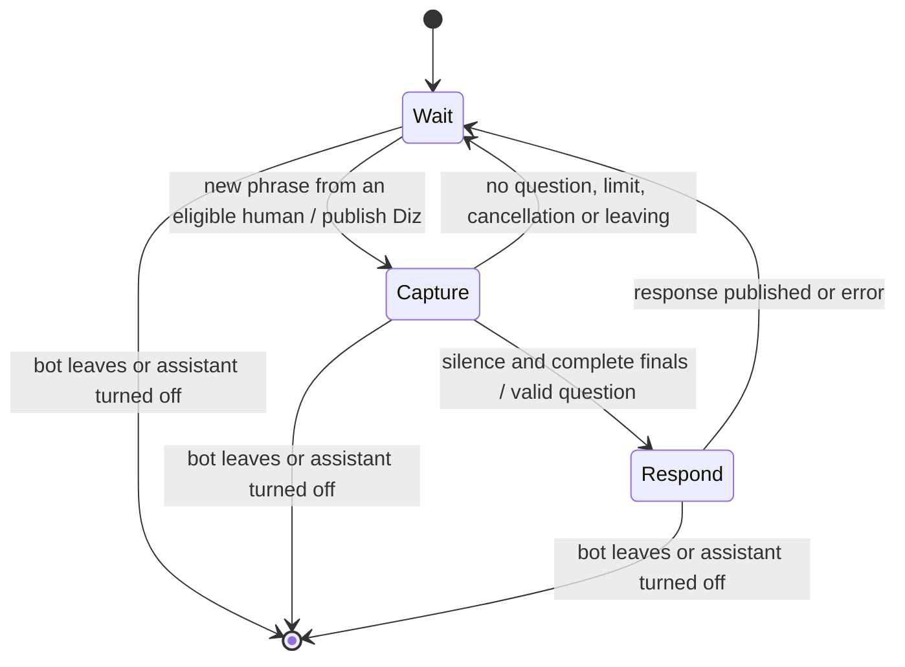

# Plan: voice assistant "Hey Bot"

Date: 2026-10-03. Status: chat and local voice implemented; Discord rehearsal pending.

## Intended experience

While the bot is in the voice channel, it continuously looks for the configured phrase.
A user says "Hey Bot", receives "Diz", asks a question and receives an answer.
Afterwards the bot goes back to looking for the phrase. Each activation corresponds to one interaction.
There is no timer that disables this listening during the call.

Example from the first version:

1. Ana: "Hey Bot".
2. Bot, in the configured text channel: "@Ana, Diz".
3. Ana: "Explain to me what polymorphism is with an example".
4. Bot, in the same channel: recognised question and short answer in Portuguese.
5. The next request requires "Hey Bot" again.

"Diz" and the response are written in the chat and spoken with local TTS in PT-PT.
Also accept "Hey Bot, explain…" without
forcing the user to wait for the confirmation.

## Decisions assumed after the grilling

The user authorised closing the remaining decisions at the agent's judgement.
These values are proposed defaults, adjustable after a real rehearsal.

| Decision | Choice and reason |
| --- | --- |
| Availability | Active by default when the bot is in a call; it remains so until leaving or being turned off by command. |
| Configuration scope | Per server, persisted; reuse the existing settings. |
| Who configures | Manage Server permission, like `/streaming`. |
| Who can ask | Humans present in the bot's voice channel, with Realtime available. Ignore bots. |
| Request ownership | Only the person who said the phrase can provide the question. Other voices do not enter the request. |
| Concurrency | One active interaction per call. Another activation receives a busy indication, with no queue of old audio. |
| Repetition | Repeating the phrase during capture does not create another request. During the response, it does not interrupt the LLM in this version. |
| Phrase | Default "Olá macaco"; 2 to 5 words, up to 50 characters, normalised for case, accents and punctuation. Validate that a useful phrase remains. |
| Detection | Any position in the utterance, in the right order; ignore accents/punctuation/case, tolerate one recognition error, two interleaved words and words joined/separated. Accept a boundary between finals from the same author. |
| End of the question | Continuous silence from the author, configured by `ASSISTANT_SILENCE_SECONDS` (default 5; 0.5–20 seconds). New speech from the author restarts the counter; other voices and arriving text do not restart it. Wait for pending finals before sending a single question to the LLM. |
| No question | 10 seconds after receiving the activation to start; warn and return to waiting. |
| Long request | Maximum of 30 seconds of capture after receiving the activation; if exceeded, ask for a shorter question, without replying to an arbitrary cut. |
| Cancellation | "Cancel" as an isolated utterance from the author during capture cancels. Leaving the channel also cancels. |
| Response | General assistant, Portuguese by default, concise answer; without executing actions, searching the internet or loading the whole server history. |
| Errors | 30-second timeout for the LLM request; indicate failure and return to waiting. Without automatically repeating a response that may already have been published. |
| Changing configuration | Apply atomically; cancel the pending capture if the phrase, channel or state changes. |
| Restart | Return to waiting with new events; never activate on old transcripts. |

The capture and response limits do not disable continuous listening. They only end
one interaction and release the bot for the next activation.

## Existing base and real impediments

- `discord_bot/streaming.go` already sends PCM per user to the Python API through
  WebSocket, with a reader for control messages in the opposite direction.
- `src/transcription-api/app/realtime.py` receives Speechmatics finals with start/end
  timestamps and persists them. The finals are not yet sent to Go through the WebSocket.
- `discord_bot/said_keywords.go` looks for words in any order in the whole transcript,
  queried every second. It deduplicates once per recording. That mechanism
  does not support several questions in the same recording nor delimit the text after
  the phrase. Preserve the existing trigger; create dedicated logic for the assistant.
- `/oracle` and `app/llm.py` already have LLM transport and chat responses. The oracle requires
  server context: it is not directly suitable for general questions without history.
- `src/data/repository.py` already persists transcription preferences per server.
- `discord_bot/music.go` sends audio to Discord and shares the output with the local TTS
  by music frames and by full voice response, without interleaving streams.

**Capacity is an acceptance condition:** the current pool reserves two people per distinct
key and passes the rest to Batch. Batch may wait 10 seconds of silence
or up to 300 seconds of recording, plus transcription. It is not suitable for this assistant.

The prototype can use the participants with a Realtime slot, but the experience for
everyone is only complete when there is capacity for all participants of the
target scenario. Do not raise limits in the code assuming the provider allows them.
Before developing, measure the target call and confirm available capacity. If
it is insufficient, expand the provider's authorised capacity; if that is not
viable, open an architecture decision for local detection/alternative transcription.

Status and transition warnings must identify who is not covered, without spam.
A person in Batch must not receive a delayed activation from the history.
Continuous listening with remote transcription also implies continuous use of the service;
measure minutes consumed in the rehearsal, without assuming prices or balance.

## Minimal technical flow



1. Forward finals confirmed by the existing WebSocket connection, including session,
   user, recording, generation, stable segment identity and audio timestamps.
   Persist first; explicitly report delivery/stream failures.
2. In Go, consume these events without repeatedly querying the full transcript.
   Keep a bounded window of the current utterance and the active request, with
   deduplication limited to the connection/recording lifecycle.
3. Detect the phrase with limited tolerance, including when it splits between finals.
   Remove only the activation; preserve the question before and after in the same utterance.
   A pause greater than the configured silence separates the previous context.
   Associate each activation with its position in the audio, not only with the recording ID.
4. Capture new events only from the author. Associate speech activity and finals
   progress with the same audio clock. Handle silence/DTX with the existing PCM and
   mechanisms; validate in the rehearsal whether an additional silence detector is needed.
5. Do not close the question while there is later speech still to be finalised. If
   it is not possible to obtain finals within a limited deadline, fail explicitly
   and return to waiting, instead of replying to incomplete text.
6. Run the LLM outside the audio reception cycle. Use the existing response transport and
   cleanup with a method for a general question, without requiring the oracle.
7. Publish a response addressed to the author, with the recognised question to make
   corrections easier. Respect Discord message limits through the existing helpers.

A Realtime failure cancels the affected capture and reports unavailability; the existing Batch
recording can continue for its own purposes, but does not activate the assistant.
Repeated events, from obsolete generations, recovered by Batch or after closing, cannot
produce a second response. Turning off the assistant also invalidates
the publication of an LLM response that finishes after that shutdown.

## Proposed commands

```text
/assistant status
/assistant phrase value:"Hey Bot"
/assistant channel value:#bot
/assistant enable
/assistant disable
```

`status` shows the phrase, state, destination and Realtime coverage. The change commands
require Manage Server. Confirm persistence before confirming success to the user.
Reuse the current summary destination as the default; if there is no valid destination,
indicate the missing configuration and do not start requests that cannot have a response.
Do not include a voice option that is not implemented yet.

## Implementation order and exit criteria

### 1. Prove reception and capacity in a real call

Measure the time between speaking the phrase and receiving the final, verify the coverage of the
participants and test activation after long periods of silence. Confirm
that the first word is not lost when opening/reopening streams. Record latency and
consumption. Resolve the capacity of the target scenario before declaring support for everyone.

### 2. Configuration and event delivery

Add settings and commands; forward finals in the WebSocket and validate identity,
order, generation and timestamps. Preserve transcription, Batch, summaries and the "pijama" trigger.
Criterion: phrase/channel survive a restart and old events do not activate requests.

### 3. Activation and capture of a question

Implement the per-call state machine, "Diz" confirmation, question cropping,
silence, limits, cancellation and ownership per author.
Criterion: several activations in the same recording work, each with its own question.

### 4. Response in the chat

Add the general question to the LLM contract and the existing API; integrate it in the bot with
a timeout and return to the waiting state. Update documentation and run the relevant
Go/Python checks and the integration tests of the changed persistence.
Criterion: it works on a server without history and does not execute commands by voice.

### 5. Acceptance validation

Cover with deterministic tests the phrase/segment limits, question in the same
sentence, two activations in the same recording, overlapping voices, silence, cancellation,
timeout, configuration change, deduplication, Batch recovery and delayed finals.
Do a Discord rehearsal with two humans and music, leaving/re-entering and a streaming failure.

Initial targets to measure, not guarantees: "Diz" within 2 seconds after finishing the phrase;
response within 10 seconds after finishing a short question. Measure the 95th percentile in
at least 20 interactions, also counting failed or false activations. If the
finals do not allow the first target, investigate partials only for activation;
keep capture and response based on finals. Never hide latency by changing
the start of the measurement to the arrival of the transcription.

### 6. Voice, after validating the chat

Implemented the "Diz" confirmation and the response with local TTS in European Portuguese.
It reuses the Discord encoder/output and suspends music frames during voice, without
losing position or changing manual pauses. It ignores bot audio in detection and
keeps the response in the chat if TTS fails. The output is chat and voice by default, or only
chat with `ASSISTANT_VOICE_ENABLED=false`. Comparison with remote voice and the choice
per server are left for a later need.

## Out of this implementation

Continuous conversation, dialogue memory, actions/commands by voice, web search,
barge-in during the response, request queues, wake word with a local model and support
for several API processes. Reopen those decisions only when there is a demonstrated
need; do not create infrastructure in advance for them.


## Implementation status (2026-10-03)

The configuration, finals delivery, activation/capture and
chat response stages are implemented. `/assistant` persists the settings per server and invalidates requests
in progress. The existing transport delivers only new and confirmed finals with
identity, generation and timestamps; Batch does not activate the assistant. Go keeps one interaction
per call and uses PCM activity, silence/DTX and finals progress to close
requests. There are latency logs up to publication and coverage per participant.

Local verification: Go tests with the race detector; Python tests, including Postgres
isolated per schema and a simulated WebSocket provider. The Python test
`test_final_context_budget_includes_all_prompt_and_memory` already fails in the previous code
due to insufficient budget for the oracle prompt; it does not belong to the assistant.

Stage 1 and the rehearsal of stage 5 **were not carried out**: in this execution there is no
controlled Discord call with humans to measure capacity, p95 and consumption. Provider limits
were not changed nor is support for all participants declared.
The existing `/streaming` preference continues to control Realtime availability;
use it with `mode:on` before the rehearsal. Local voice was added at the user's
request; quality assessment, p95 and consumption in a real call remain pending.

PCM energy uses an initial RMS threshold of 500 in S16LE, adjustable by
`ASSISTANT_SPEECH_RMS`. Validate the threshold with low speech,
noise, microphones and music; if the heuristic does not delimit speech adequately,
replace it with a proven detector. Requests with pending finals fail after
5 additional seconds beyond the configured silence, instead of sending incomplete text.
Partials remain active at the provider and only communicate the timestamps to the bot; they never
provide text to the question. Their audio timestamps help detect low speech,
but the moment the text arrives does not restart the silence. Numbers and dates formatted as entities
are also preserved, including punctuation and results with several words.


Phrase update: default "Olá macaco", changeable by
`/assistant phrase value:"outra frase"`. Detection looks for the phrase in any
position, ignoring case, accents and punctuation; "ola macaco" and "Olá, Macaco" are
equivalent. It also accepts "olha macaco", "olá meu macaco", "olamacaco" and small
one-letter errors. It preserves the question before/after, including distinct finals
of the same utterance. The migration updates only the old persisted default and
preserves custom phrases.

Finals fix: overlapping timestamp envelopes, overlapping words and
empty markers do not cancel the capture. Progress never goes backwards; words already
consumed do not return to the question, even in a cumulative final with another identity.
The validations of generation/author and of finite timestamps within the received audio are kept,
as well as the wait for finals covering all speech before sending to the LLM.

Voice implemented: `espeak-ng -v pt` synthesises "Diz" and the response, FFmpeg converts
to PCM and the existing Opus encoder sends the frames to the call. A dedicated output
prevents interleaving music and speech frames; the music decoder keeps the position
and the manual pauses. Text remains in the chat in case of failure and the voice has limits of
10 seconds for "Diz", 2 minutes for the response and 2000 characters before indicating
the chat for the remainder. Deactivation, configuration change and the author leaving
cancel the speech. `ASSISTANT_VOICE_ENABLED=false` allows using chat only; the default is
chat and voice. No external TTS API was added nor a per-server choice.

Verification: real PT-PT synthesis into decodable Opus packets, music blocked
during speech and resumed afterwards, preservation of manual pause, cancellation of the
processes and text fallback on TTS failure. The Discord rehearsal remains pending.
