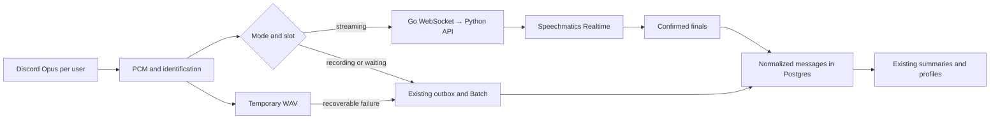

# Plan: transcription by recording or streaming

Date: 2026-10-03. Status: code implementation delivered; simulated tests executed; real rehearsal still to run.

## Objective and decisions

Allow choosing between the current recording processing and Speechmatics Realtime
transcription, reusing the existing messages, summaries and profiles.

| Topic | Decision |
| --- | --- |
| Calls | Assume a single active bot call. Do not develop coordination between calls in this version. |
| Initial mode | Defined in `.env`, with streaming off by default. |
| Command | `/streaming mode:on\|off\|status`, with server management permissions. The choice is persisted per server and applies to the current call. |
| Precedence | Choice persisted by the command; in its absence, the initial value from the environment. The environment is not a block on the command. |
| Capacity | Two slots per distinct key. As instructed by the user, assume each key belongs to a different account; do not add configuration for associating accounts. |
| Assignment | Order of entry into the call where the bot is. A slot belongs to the user until they leave, even without speaking. |
| Waiting | FIFO of the call; while waiting, the user is recorded and transcribed by Batch. |
| Promotion | When a slot becomes free, the first eligible user moves from recording to streaming. |
| Unknown order | Members already present when the bot starts observing, including restart: tie-break by Discord numeric ID. |
| Safety | Keep temporary audio also during streaming; delete after durable confirmation of the transcription. |
| Credits | Try another available key. If none has credits, warn on Discord, cancel the affected pending audio and delete it. Do not keep it for a later retry. |
| Language | Assume speech in European Portuguese; Realtime API configured with `language=pt`. Automatic English is outside this version. |
| Results | Finals feed the existing storage; partials do not enter summaries or profiles. |
| Logs | Queue, assignments, promotions and failures are logged in the terminal, without automatic warnings on Discord. |
| Debug | Environment flag, off by default, allows printing partial and final text in the terminal. |

The exception to the logs is the out-of-credits warning. Responses to commands continue
to exist, preferably ephemeral; they are not publication of transcriptions nor queue warnings.

The premise of one account per key is an option of this project, not a Speechmatics rule:
the documented Free limit is per account. Keys with a repeated secret do not increase capacity.
Real concurrency refusals should be treated as lack of a slot and cause fallback
to recording, without deleting audio or confusing that error with exhausted credits.

## Current base and integration points

- `discord_bot/audio.go`: input/output, call state, SSRC, closing and sending the summary.
  Currently logs connections per server; this feature assumes only one active call.
- `discord_bot/audio_convert.go`: decodes Opus to PCM S16LE, 48 kHz, stereo,
  recovers RTP losses and writes WAV. The decoder reuses buffers: copy before enqueuing.
- `discord_bot/transcription_client.go`: Batch admission, durable outbox, retry and
  session finalization barrier.
- `discord_bot/main.go` and `discord_bot/bot_language.go`: commands and permissions.
- `src/transcription-api/app/main.py`: admission of recordings and transformation of segments
  into messages with absolute timestamps.
- `src/transcription-api/app/config.py`, `transcriber.py`, `speechmatics_usage.py`:
  configuration, keys and Batch. The consumption currently measured does not represent the real balance.
- `src/transcription-api/app/workers.py` and `recording_cleanup.py`: job recovery
  and cleanup of confirmed audio.
- `src/data/repository.py` and `src/data/migrations/`: persistence, idempotency, readiness
  of summaries and profiles.
- `.env.example`, `docker-compose.yml`, READMEs and requirements: configuration and operation.

There are local changes in several of these files during the preparation of the plan. Before
implementing, re-read the current state and integrate without replacing the existing work.

## Proposed architecture



Keep the keys only in the Python API, as happens today. Go sends PCM and metadata to the
API; Python manages the Speechmatics connections and reserves the slots atomically. The initial
version uses the single API process of the current deployment. Multiple replicas or Uvicorn
processes would require a shared coordinator and are outside the scope.

The bot controls the order of participants and the call queue. The API is the authority
over reservations and key state; the bot only enters streaming after confirmation.
If a second call unexpectedly appears, do not create another pool with the same
capacity: refuse Realtime assignment in that call, keep recording and log it.
Do not change the bot's general autojoin behaviour in this feature.

## Configuration and command

Proposed configuration; the names may be adjusted to the conventions in the implementation:

```dotenv
# Initial value for servers with no persisted preference.
TRANSCRIPTION_STREAMING_ENABLED=false

# Transcribed text only appears in the terminal when this flag is true.
TRANSCRIPTION_STREAMING_DEBUG=false

# Separate configuration from the Batch melia-1/multi defaults.
SPEECHMATICS_REALTIME_URL=wss://eu.rt.speechmatics.com/v2/
SPEECHMATICS_REALTIME_MODEL=enhanced
SPEECHMATICS_REALTIME_LANGUAGE=pt
```

- Store the preference in a per-guild settings table, not in an `.env` file
  modified by the command. Persist before confirming the change to the user.
- `status` reports the effective mode, occupancy and queue size, without revealing secrets.
- `on` orders the members present by observed entry, fills slots and queues
  the excess. Batch transcriptions already admitted continue along their path.
- `off` stops admitting streams, closes/flushes the existing ones and switches to recording from
  an explicit audio limit. Do not resubmit audio already confirmed.
- With a provider other than Speechmatics or without valid keys, keep recording and
  return an explanatory error to the `on` command; do not show streaming as effectively active.
- Debug is configured by environment in the process that receives the Realtime results.
  Normal logs contain only metadata; never keys, tokens or textual transcription.

## Participation, queue and slots

1. Register real entries with a monotonic sequence before network operations.
   Mute/deafen updates and SSRC changes do not represent a new entry.
2. Consider only human users present in the current channel and eligible for
   capture. The bot, users paused by `/forget` and members of other channels do not
   occupy a slot nor enter the queue.
3. For the initial snapshot of members with unknown arrival, order by numeric
   ID, using a numeric or safe decimal comparison, without conversion to float.
   Insert new entries observed after that group, in event order.
4. Reserve at most two slots per distinct key secret. Choose among healthy keys
   by lowest occupancy, with tie-break by the existing configuration order.
5. The slot is a reservation of a user, independent of a WAV clip or WS connection.
   Inactivity does not promote another person. If the provider closes an idle connection,
   reopen it for the same holder without increasing the reservation count.
6. Those waiting use the current Batch pipeline. On promotion, close the Batch clip at the
   transition limit, keep its outbox and start a new Realtime unit. Do not send
   retroactively to Realtime audio already belonging to Batch.
7. On leaving or moving to another channel, close the participation, remove from the queue, finalize
   audio and release the slot only once. A re-entry receives a new position.
8. When moving the bot to another channel, close the streams and queue of the previous channel; build the
   queue of the new channel. Do not mix participants or priority between channels.
9. Restart reconciles real presence and rebuilds the unknown order by ID. Safety audio
   without confirmation follows Batch recovery, except if it was discarded
   for lack of credits or deleted by `/forget`.

## Transport and audio

- Create a Go client and an internal Python WebSocket endpoint for per-user audio.
  Metadata includes session, Discord ID, participation, stream/epoch and audio unit.
- Negotiate format, receive `RecognitionStarted` and only then send audio to the provider.
  Convert stereo to mono with summation in sufficient precision before the division, without
  overflow. Validate 48 kHz in the technical rehearsal; use explicit resampling if necessary.
- Preserve the order of silence, recovered audio and normal PCM. Record the offsets
  sent and the correspondence with the call's absolute timestamps.
- Use bounded queues and workers per stream; the network must not block the capture loop.
  A full queue triggers recording/fallback and a log, not unlimited memory growth.
- Keep a heartbeat; closing sends `EndOfStream`, waits for finals/`EndOfTranscript` with a
  timeout and then releases resources. On failure, reconcile audio without confirmation.
- Connection restarts create epochs with their own offsets. Large periods of silence
  can start a new epoch while keeping the reservation, avoiding accumulating silence in memory.
- Duplicate or out-of-order chunks are detected by sequence. Do not reconnect and
  resend audio without reconciling previous results.

## Persistence and fallback without duplication

The audio needs an identity independent of the transcription mode. Introduce durable
units per user/participation, aligned with the clips/transition limits.
A Realtime connection can span several units; word timestamps allow
associating results with the correct unit without duplicating words at the limits.

Proposed migration, to be detailed during implementation:

- Streaming settings per guild.
- Participations/streams with identity, key by name, epoch, offsets and state.
- Audio units with WAV, interval, processing owner, version and state.
- Final segments with idempotent identity and origin/unit associated with the messages.
- Terminal state of discard for credits, reason and pending cleanup.

Work states: `recording`, `streaming`, `fallback_pending`, `completed` and
`discarded_no_credits`. States and transitions must be persisted before irreversible
side effects. Delayed events use generation/version so as not to reopen finished work.

Proposed policy:

1. Persist each Realtime final idempotently; `AudioAdded` does not mean that
   text was stored. Partials are only used by debug.
2. A unit is only complete after the audio is closed and all expected finals are
   confirmed. Only then is it eligible for normal cleanup and profile updates.
3. On recoverable failure, retain the WAV and route the incomplete unit to Batch.
   Batch results atomically replace the Realtime messages of the same unit;
   they are not added on top. Recalculate the affected chunks in that transaction.
4. Before processing fallback, invalidate the Realtime generation of that unit. Late
   or repeated results do not insert messages again nor beat the Batch result.
5. Profiles/LLM only receive units completed or definitively closed. This avoids
   incorporating twice a unit whose text was replaced by fallback.
6. `/recap` can use the finals already stored, but the final call summary waits for
   streams, flush and admitted jobs. A timeout with recoverable audio routes to Batch;
   discard for credits is terminal and does not block the summary.
7. Do not resend completed units on restart, `/retry`, promotion or mode change.

## Failures and lack of credits

| Situation | Behaviour |
| --- | --- |
| Slots occupied | FIFO and recording; log only. |
| Provider concurrency refusal | Try another key with capacity; otherwise, recording and log. Do not declare exhausted credits. |
| Network failure, timeout or full audio queue | Durable fallback to Batch, retry with limited backoff and log only. |
| Invalid key or incompatible configuration | Remove the key from the usable pool and log the error; do not delete audio for that reason. |
| One key without credits | Mark it unavailable for new transcriptions, try another key without exceeding slots and preserve the participant's order/reservation. |
| All accounts without credits, confirmed by the provider | Warning on Discord; discard the affected pending audio and suspend capture of new audio for transcription in that call. |

Do not infer lack of credits from a percentage of the configured budget, from
a generic error, from lack of keys, or from unavailability of the usage query. Map
concrete provider responses in the technical rehearsal and cover them with tests.

On discard for credits:

- Preserve messages/text already confirmed. Close partially confirmed units
  keeping that text, without accepting late finals of the remaining audio.
- Mark affected units and pending jobs as discarded before cleaning files;
  invalidate callbacks and prevent workers/replay from continuing the cancelled work.
- Delete WAV, buffers, outbox and sidecars of those jobs. Try to cancel remote jobs
  if the API allows it; the impossibility of cancelling remotely does not authorize reinsertion.
- Cleanup is idempotent, confined to the recordings folder, and is repeated after restart if
  it fails. An unlink failure does not turn a discarded job into a job to transcribe.
- Emit one warning per exhaustion episode in the call's summary channel. Store
  the warning state to avoid spam/repetition after restart; a send failure stays in the logs.
- Suggested message: "Speechmatics credits ran out. The transcription of this call
  was interrupted and the pending audio was deleted. The text already transcribed was preserved."
  Send after cleanup; if there is pending cleanup, say that it will be deleted.
- Keep the bot in the call and the other functions available. A new call or explicit
  `on` command allows re-evaluating the keys; do not recover already discarded audio.

This policy also applies to Batch recordings of the call when all Speechmatics
accounts are out of credits. Do not introduce automatic fallback to Whisper.

## Logs, debug and data deletion

- Structured logs: session, user, key name, slot, position, transition, reason,
  offset, pending units and latency. Do not repeat a queue log on every packet.
- Debug prints partials and finals with session/user and result type, without secrets.
  Partials that change are not counted as new persisted messages.
- Integrate `/forget` into the stream barrier: pause capture, remove from the queue, invalidate
  generations, close WS, cancel jobs, clean audio and only then confirm deletion.
  No late final or retry can recreate data of the deleted user.
- Extend the existing recovery/cleanup to streaming and discarded units, without
  deleting recordings of other users or work still recoverable.
- Account separately for Realtime and Batch usage. Reserved slots are not hours of
  transcribed audio; fallback effectively sent can consume both products.

## Development phases

### 1. Validate protocol and settle technical contracts

- Isolated Realtime rehearsal with PCM, `enhanced`, `pt`, finals, partials, heartbeat and flush.
- Confirm concurrency codes, authentication, credits and timestamp format.
- Fix Go/API contracts, identifiers, queue limits and timeouts; create a WS simulator.
- Keep Batch `melia-1/multi` separate. Do not use the eventual presence of Melia in the
  WS reference enum as proof of Realtime support.

### 2. Configuration, persistence and control

- Add settings/envs, migration, settings endpoint and Discord command.
- Implement effective mode, per-server persistence, permissions and `status`.
- Add participation tracking, FIFO and a manager for two reservations per distinct key.
- Verify ordering, exits, re-entries, mute, snapshots and restart without a paid API.

### 3. Capture and Realtime transport

- Separate PCM production from the destinations without changing the existing RTP recovery.
- Implement the Go client, internal endpoint, Speechmatics client and bounded queues.
- Keep a safety WAV and explicit limits at the Batch/streaming transitions.
- Implement reservation independent of activity, heartbeat, epochs and closing with flush.

### 4. Results, fallback and recovery

- Persist finals and units; reuse message/timestamp normalization.
- Implement atomic replacement in fallback and prevent insertions from old generations.
- Integrate summary barriers, profiles, `/forget`, restart, outbox and cleanup.
- Ensure that turning on/off during speech does not lose audio nor duplicate transcriptions.

### 5. Credits, observability and documentation

- Implement error classification, attempt between keys and terminal discard.
- Integrate a single warning on Discord and prevent replay of deleted recordings.
- Add transition logs, textual debug and separate Realtime usage reporting.
- Update `.env.example`, compose, requirements and operational documentation.

### 6. Final verification and activation

- Run the relevant Go/Python tests and integration in a disposable Postgres.
- Verify in a controlled call recording mode, streaming mode and a queue with excess
  participants. Use simulated tests for credits and destructive failures.
- Do the first real rehearsal with one key and debug enabled; then test several keys.
- Deliver with streaming off by default. Revert the mode with `/streaming off`
  or change the initial value for installations with no persisted preference.

## Acceptance criteria and tests

- Streaming off preserves the current recording, outbox, summaries and profiles path.
- `.env` only defines the initial mode; an authorized command persists and changes the current call.
- One distinct key gives two slots; three participants leave the third in recording/FIFO.
  Two distinct keys allow four holders; duplicated keys do not increase capacity.
- Silence does not free a slot. Exiting promotes the first in the queue, without duplicating the previous Batch.
- Mute updates, new SSRCs and reconnections do not change priority nor increase reservations.
- Restart/snapshot uses stable tie-break by ID; re-entry goes to the end of the queue.
- Concurrent assignments never exceed two reservations per key; closing is idempotent.
- PCM preserves order, identity and timestamps across RTP losses, silence and epochs.
- Slow network/full queue does not block other users nor let buffers grow without limit.
- Repeated/late finals do not duplicate messages. Fallback replaces only the
  affected unit and profiles do not absorb results of two versions of the same unit.
- Turning off during speech, exit, channel change and `/stop` complete or recover audio;
  the summary only runs after the necessary barriers.
- A concurrency/network error does not cause deletion for credits.
- Exhausted credits on one key try another; all exhausted cause a single warning, discard
  and cleanup. Restart and `/retry` never resurrect that audio; confirmed text remains.
- A cleanup or warning send failure is recoverable without restarting a discarded transcription.
- `/forget` deletes data and prevents recreation by late events or jobs.
- There are no captions nor queue/promotion warnings on Discord. Debug off does not print transcription;
  debug on prints results in the terminal. Logs never include credentials.
- PT-PT is tested with representative audio, using the Speechmatics code `pt`.

Existing verification commands, to be run during implementation:

```bash
PYTHONPATH=src:src/transcription-api .venv/bin/pytest -q src/transcription-api/tests
cd discord_bot
go test -race ./...
```

Integration tests use a disposable `TEST_DATABASE_URL`; Go requires Opus/opusfile.
Automated tests must use simulated providers, without real credits or Discord.
This plan does not imply that those tests or rehearsals have been executed.

## Verified references

- [Realtime limits: Free, concurrency and closing](https://docs.speechmatics.com/speech-to-text/realtime/limits).
- [Quickstart: WebSocket, finals and partials](https://docs.speechmatics.com/speech-to-text/realtime/quickstart).
- [Realtime audio](https://docs.speechmatics.com/speech-to-text/realtime/input).
- [Models: Enhanced/Standard Realtime; Melia Batch](https://docs.speechmatics.com/speech-to-text/models).
- [Languages: Portuguese uses code pt](https://docs.speechmatics.com/speech-to-text/languages).
- [WebSocket reference](https://docs.speechmatics.com/api-ref/realtime-transcription-websocket).
- [Discord Voice State: does not include an entry timestamp](https://docs.discord.com/developers/resources/voice#voice-state-object-voice-state-structure).

Plan prepared with the `grilling` skill, after an interview and confirmation that the remaining
choices are left to the implementer's discretion. No changes to the code in this task.


## Implementation delivery — 2026-10-03

Implemented the Go → internal WebSocket → Speechmatics Realtime path, with the command
`/streaming mode:on|off|status`, a preference persisted per guild and disabled by default.
The local changes prior to the implementation were preserved.

- FIFO per participation, numeric snapshot, entries observed before network operations,
  reservations independent of activity, two slots per distinct secret and refusal
  of another call while the pool is busy.
- int32 downmix, copy of the Opus buffers, queue limited per epoch, explicit sequence,
  heartbeat, negotiation and flush with timeout. Transitions close units without retroactively
  reusing Batch audio. One epoch corresponds to one WAV in this implementation.
- Migration `006_streaming.sql`, idempotent finals associated with the WAV, invalidation of
  generations, atomic replacement by Batch, summary/profile barriers and recovery
  of interrupted headers. `/retry` ignores outboxes of WAVs still open.
- `/forget` pauses/closes capture and invalidates units, interrupts polling and tries to cancel
  remote jobs before deletion; late callbacks cannot recreate data.
- Confirmed credits try another key; discarding all keys is terminal and
  precedes cleanup. Pending warnings have a persisted episode and a Discord nonce. The nonce
  only covers a few minutes on Discord; a prolonged failure that occurs simultaneously after sending and
  before persisted confirmation may require manual reconciliation of the warning.
- Variables in the environment/Compose example, separate Realtime usage, opt-in textual
  debug and operational documentation in the READMEs.

Verification executed with simulated providers and a disposable Postgres 17, isolated
per schema in each test; no real Speechmatics or Discord credits were used:

- Go: `go test -race ./...` and `go vet ./...` passed, including mode boundaries
  with real Opus, downmix, queues, FIFO, WAV repair and active outbox.
- Python: **138 passed; 1 failed** in the full suite. The 15 streaming cases
  passed. The pre-existing failure is
  `test_review_python.py::test_final_context_budget_includes_all_prompt_and_memory`:
  the oracle prompt exceeds the 4000-character budget. `llm.py` and that test were not
  changed by this implementation.
- Ruff on the changed Python files, `git diff --check` and
  `docker compose config --quiet` passed. The Compose validation used placeholders
  only for the mandatory Discord values. The global lint also identified
  a pre-existing import ordering in `src/data/__init__.py`.

To be run: a controlled call with PT-PT audio and real Speechmatics, first with
one key/debug enabled and then several keys. The software keeps streaming off
by default; `/streaming mode:off` is the operational rollback.
