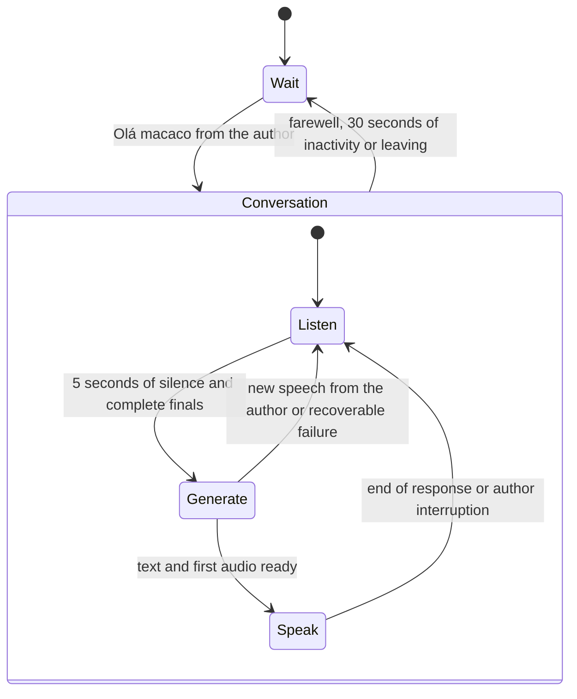

# Plan: continuous conversation with "Olá macaco"

Date: 2026-10-06. Status: implementation complete and verified locally; real Discord rehearsal pending. Decisions confirmed by the user after three rounds of Grilling and final confirmation.

## Confirmed objective

"Olá macaco" opens a natural conversation. The user can keep speaking without
repeating the activation on every reply. The bot receives context from the last minutes of the
call and keeps the thread of the conversation. "Adeus macaco" ends the conversation; a period
of inactivity also ends it: 30 seconds available for the author to reply,
not counting the time spent generating and playing the bot's response.

## Facts about the current code

- `discord_bot/assistant.go` keeps one request per call and runs `reset()` after
  replying. While it replies, it discards new words from the author for the request.
- Capture already associates utterances with users, waits for silence and confirmed finals,
  preserves questions between recordings and cancels operations through Go contexts.
- The confirmation and the response can already be published at the start of voice
  playback; synthesis already produces audio per segment and keeps the text alternative.
- `/v1/assistant/question` inserts questions and answers into the existing persistence.
  The current context uses `get_guild_oracle_context`, which gathers messages, profiles,
  summaries and bulks from the whole server. It does not guarantee the window of the current call.
- `get_session_messages(session_id)` already isolates the call, identifies authors and orders
  messages; currently it reads the entire call. Realtime persists each final before
  sending it to the bot, so there is no need to wait for a bulk to close.
- `format_transcript` already formats names, timestamps and authorship. Bulks remain useful
  as background memory; they are aggregated per server and processed after closing.

## First round: confirmed decisions

The user confirmed these choices through the selectable options.

| Decision | Confirmed choice | Consequence |
| --- | --- | --- |
| Who converses | The person who activated; other voices are context | Other people do not provide turns to the active conversation |
| Recent window | Last 5 minutes of the current call | Refresh the context on every turn, in addition to the dialogue history |
| End of a turn | 5 seconds of silence from the author, waiting for finals | Preserve margin for pauses in the middle of a sentence |
| Inactivity | 30 seconds for the user to reply; suspend during bot generation and voice | Start a new window when the response ends |

## Second round: confirmed decisions

| Decision | Confirmed choice |
| --- | --- |
| Interruption | New speech from the author interrupts generation or voice; listen to the new turn and reply after 5 seconds of pause |
| Side talk | All speech from the author during the conversation is directed at the bot; the author ends the conversation before talking on the side |
| Another activation | Keep the current author; tell the other person that the bot is busy |
| Farewell | Accept an isolated farewell and "obrigado, adeus macaco"; do not end on a quotation inside a question |

## Third round: confirmed decisions

| Decision | Confirmed choice |
| --- | --- |
| Length | 2–4 sentences by default; expand when the author asks |
| Chat | Show the author's recognised speech and the response; publish the response at the start of the voice |
| Explicit end | Reply to the farewell with a short farewell |
| End by inactivity | Close silently after 30 seconds available to reply |
| Failures | Short warning, keep the conversation until the timeout and allow retrying without a new activation |
| Duration of a turn | Up to 60 seconds of speech/capture; if exceeded, ask to shorten instead of replying to an arbitrary cut |

"Olá macaco" on its own receives the confirmation once and opens the 30-second window
to begin. A question included in the activation starts the first turn right away.
The 30-second window replaces the previous version's initial 10-second deadline.
Keep the validated limit of 2000 characters per utterance: exceeding duration or text
produces a warning to shorten, without sending only part of the question to the LLM.
Speech from the author restarts inactivity; five seconds of silence close each turn.
Other people, noise and artificial silence do not restart the author's clocks.

## Minimal solution with Ponytail

1. **Distinguish conversation from turn in the existing controller.** The conversation keeps
   the author, timestamps and limited history. The current request continues to delimit
   one utterance and one response. Completing a turn clears only the request; ending the
   conversation also clears the transient history and returns to looking for activation.
   Keep one active conversation per call, with no new manager,
   conversation queues or concurrent sessions per user.
2. **Two separate clocks.** A short pause closes the turn to obtain a
   response. The long pause ends the conversation. Noise, artificial silence,
   delayed transcripts and the bot's voice cannot extend the conversation as if
   they were new speech from the user. Apply the 60-second capture limit per turn and
   keep the existing 30-second deadline for the LLM separately from
   inactivity. Suspend inactivity during generation/voice; give a new window
   of 30 seconds when the response or a recoverable warning ends.
3. **Recent context and dialogue history kept separate.** Add a small
   query with `session_id`, time window and result limit; reuse
   the existing formatting. Refresh the window on every turn. Do not wait for
   bulk summaries, nor use memory from other calls as a substitute.
   Take to the LLM the last turns of the active conversation, with author and role clearly
   identified, without distilling them as evidence: "and in that case?" must keep
   the reference to the previous response. Apply the existing `LLM_CONTEXT_CHARS` budget to the full prompt.
   Store at most 12 recent exchanges (24 messages), without cutting the current utterance;
   prioritise the most recent dialogue and fill the remaining space with recent
   context from the call. If the window exceeds the budget, use the most
   recent part and identify partial coverage, without claiming access to the whole conversation.
   Do not introduce an additional LLM call to summarise each turn.
4. **Reuse API and persistence.** Extend the current question contract to
   carry the limited history; validate fields and limits in the API. Identity
   and recent context remain associated with the existing call. Persist each
   question/answer through the current path. Active history stays in memory and is not
   reactivated after a restart. No migration while there is no confirmed
   need to recover open conversations.
5. **Explicit closing and interruptions.** Recognise the author's farewell
   after normalising accents, case and punctuation; accept an isolated "adeus macaco" and
   courtesy variants such as "obrigado, adeus macaco". A question that quotes the
   expression does not end the conversation. Only the author can end it by speech.
   Also end when the author leaves, the bot changes channel or the assistant is
   turned off. Invalidate pending operations and use the existing cancellations.
   A normal recording rotation keeps the conversation and the turn. While generating or speaking,
   keep consuming new speech from the author: interrupt the response, keep the
   new speech and wait five seconds of silence before replying again.
   Ignore other voices for interruption; do not treat noise spikes as speech.
   Generated responses that were never published do not enter as bot responses
   in the history. If the text was already published and the voice was cut, mark the
   playback as interrupted. Preserve the previous question still without a delivered
   answer, to understand additions such as "and it uses Python".
6. **Conversational delivery and failures.** Confirm the opening once; avoid
   repeating "Diz" between turns. Natural responses in PT-PT, with 2–4 sentences by
   default and development on request. Show recognised speech and response in the
   chat; keep the start of voice aligned with the written response. The explicit
   farewell receives a short, fixed response, without generating a new LLM turn.
   Timeout ends silently. Recognition/LLM failure produces a short warning
   and returns to listening in the same conversation; do not reply to incomplete text.
   If Realtime goes down, keep the conversation until the timeout and accept new speech after
   coverage recovers; Batch cannot reactivate or feed old turns.
   Voice failure keeps the response as text. Do not automatically repeat a
   Discord publication whose result is ambiguous, nor produce warnings in a loop.
   Spontaneous reactions wait for the entire active conversation, including the pauses.

Reuse the existing STT, LLM, Piper, Discord transport and memory. No new
provider, new SDK, vector DB, second conversation process, per-turn summarisation
or additional intent classification without a confirmed need. Only change
the architecture if measurements show that the current components prevent the experience.

## Flow approved across the rounds

Without voice available, text delivery returns directly to listening.
A new activation by another person keeps the current conversation and receives a busy
warning with the existing rate limit. All speech from the author counts
as directed at the bot, including clear interjections; do not add a classifier
for side conversations. The person ends the conversation before talking on the side.

## Implementation sequence

1. Implement recent context and dialogue history, with per-call isolation
   and verifiable prompt budget.
2. Implement continuity between turns, farewell and the inactivity clock in the
   controller; keep the earlier capture and delivery fixes.
3. Apply interruptions, recoverable failures, short responses and chat messages.
4. Run the relevant tests and validate in a real call with two people,
   pauses, noise and music. Measure activation, turn closing, first voice and end.

## Acceptance criteria

- One activation allows at least three consecutive exchanges without repeating the phrase.
- Questions such as "why?" and "give another example" keep the reference to the dialogue.
- The bot uses recent speech from the call, including finals from an open bulk; names,
  timestamps and authorship are preserved and another call does not enter that context.
- Five seconds of silence close the turn; 30 seconds of inactivity end
  the conversation. Generation and voice suspend inactivity. Speech of up to 60 seconds
  can end normally; exceeding the limit does not produce a partial response.
- "Adeus macaco" and "obrigado, adeus macaco" end with a short farewell; a
  question about the expression does not end the conversation. Timeout ends in silence.
- A recording rotation does not end the conversation nor lose delayed segments.
- Duplicate/old events and responses after closing do not generate new speech.
- Voice failure keeps the response as text; cancellation does not publish old text.
- The author interrupts generation and playback; the new speech and the relevant
  previous question are preserved. Another person does not interrupt or take over the conversation.
- A recoverable failure allows retrying without a new activation. Turning off the assistant
  or leaving the call immediately cancels the conversation and pending publications.
- History and context are bounded, without growth proportional to the total
  duration of the call. Restarting returns to waiting for a new activation.

## Limits and operational verification

Do not create new tables, providers or per-server settings. Reuse
`ASSISTANT_SILENCE_SECONDS=5`; add only duration controls in the environment
for inactivity (30 seconds) and capture (60 seconds), with value validation.
Transient state restarts in the waiting state after a restart; exchanges already persisted
remain available to the existing memory. Realtime coverage continues to depend
on the current reservations. Speech context not yet transcribed will not be available.

Cancelling the local operation must prevent obsolete delivery, even if the LLM client
does not allow interrupting remote work already started. Do not promise that
cancellation saves all tokens of an ongoing generation. Measure first-voice latency
and consumption in a test call; do not promise a full response in
five seconds, since that interval is only the pause to close the turn.

The Discord rehearsal is still necessary: local tests do not measure microphone echo,
real noise, Realtime coverage of the participants or provider latency.

## Implementation and verification — 2026-10-06

- Implemented context from the last five minutes per call (maximum 500 finals),
  active history of 24 messages, API validation and full prompt budget.
  The dialogue preserves authorship, roles, questions without a delivered answer and interrupted voice;
  context reduction uses the recent data and marks partial coverage, without another LLM.
- Implemented continuity, fixed farewell, five-second pause, inactivity of
  30 seconds available and capture of up to 60 seconds/2000 characters. Generation and voice
  suspend inactivity. Noise and empty finals do not start turns nor renew the window.
- Implemented interruptions by recognised speech from the author, recovery without activation,
  waiting for finals from previous recordings and immediate cancellation when turning off,
  leaving or changing channel. The Discord publication receives the operation's cancellable context;
  ambiguous results are not repeated. Spontaneous reactions wait for the whole conversation.
- Added `ASSISTANT_INACTIVITY_SECONDS` and `ASSISTANT_CAPTURE_SECONDS` to the environment
  and Docker Compose, with valid ranges of 5–300 seconds. No new dependencies,
  migrations or tables. Documentation updated in `README.md` and in the API documentation.
- Local verification: 213 API/Python tests with a disposable PostgreSQL, nine synthesis
  tests, `go test -race ./...`, lint of the changed files and Compose validation.
  The global lint keeps a pre-existing import ordering failure in
  `src/data/__init__.py`; that file was not changed.
- Pending: real call with two people, pauses, noise and music. The logs
  `assistant activation`, `assistant turn closed`, `assistant delivery` (`voice_ready`)
  and `assistant response` allow measuring opening, turn closing, delivery at the start
  of voice and end. Also measure consumption in `/keys`; local tests do not measure provider
  latency, echo or recognition accuracy.
